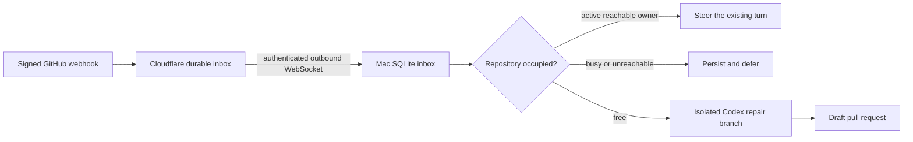

# Event Bridge

An event-driven macOS companion that triages Codex review findings and failed GitHub Actions runs with your existing ChatGPT sign-in. It never scans GitHub on a timer and never needs an OpenAI API key.



## Behavior

- Accepts only configured repositories and trusted Codex review authors. Clean reviews, successful CI and unrelated events are ignored.
- Revalidates the exact PR, commit and workflow before work. Superseded failures and closed PRs do not start repairs.
- Verifies GitHub HMAC signatures, bounds request bodies, persists before acknowledgement and deduplicates semantic event IDs.
- Observes Codex lifecycle logs and repository filesystem events. Dirty checkouts, ambiguous or unscoped active owners and unavailable ownership evidence defer or block work.
- Sends findings to the existing active turn through `codex app-server proxy` and `turn/steer` when the shared control server is available. **The desktop app does not necessarily expose that server. If it is unavailable, the event stays deferred; the bridge never uses concurrent `codex exec resume` as a substitute.**
- Starts at most one repair per repository, in a separate clone and branch. A newly detected human owner stops the worker. Repairs may open draft PRs; they never merge, deploy, force-push or write to the original PR branch.
- Enforces ChatGPT authentication and removes API-key environment variables from agent children. Subscription limits still apply. Cloudflare usage follows your Cloudflare plan.
- Reconnection backoff, operation deadlines and filesystem-event debouncing are transport/control timers, not periodic GitHub checks.

## Requirements

macOS, Node.js 24+, Git, `gh`, the Codex CLI, and the `creds` Keychain CLI. Sign in with `gh auth login` and `codex login`; `codex login status` must report ChatGPT. Cloudflare Workers and SQLite Durable Objects must be available in your account.

Read [the security contract](SECURITY.md) before enabling automatic execution.

## Install

```bash
npm ci
npm run check
npm test
npm run setup -- /path/to/projects /path/to/config.json https://bridge.example.com
node src/cli.ts install
node src/cli.ts hooks
```

The Cloudflare Worker is named `event-bridge`. GitHub is its first supported event source; the generic JSON module-registration API discussed for future sources is not implemented yet. Existing local paths and the launchd label retain their original names to preserve state.

Before installing hooks, attach the dedicated hostname to the Worker and configure hostname-scoped edge rules. Public `workers.dev` and preview routes are disabled in the deployment configuration, and Worker CPU time is limited to 50 ms per invocation. Setup requires the dedicated HTTPS URL on first use and preserves it on subsequent runs.

Setup discovers only direct Git checkouts owned by the authenticated GitHub account and resolves canonical GitHub names, excludes archived/disabled repositories, and deduplicates remotes. Inspect the generated repository allowlist **before** installing hooks. New repositories are not enrolled silently: rerun setup and hooks explicitly. Setup uses the existing `cloudflare/account/id` and `cloudflare/wrangler/api-key` Keychain entries; it creates bridge-specific webhook and client secrets without printing them. No local path, account identifier, token, event payload or execution report belongs in Git.

Configuration lives in `~/.config/codex-github-bridge/config.json`. State and reports live in `~/Library/Application Support/codex-github-bridge/`. The launchd label is `com.codex.github-bridge`; it has no calendar or interval trigger. The Mac connects outward; no inbound port is opened on the Mac. The relay keeps pending events while the Mac is asleep.

## Inspect and recover

```bash
node src/cli.ts status
launchctl print gui/$(id -u)/com.codex.github-bridge
node src/cli.ts retry /path/to/config.json EVENT_ID --reconciled
launchctl kickstart -k gui/$(id -u)/com.codex.github-bridge
```

Queue states distinguish `queued`, `deferred`, `forwarding`, `forwarded`, `running`, `completed`, `ignored` and `blocked`. `forwarded` proves delivery to the owner, not that the defect has been fixed. `completed` means the agent finished; inspect its report for tests, draft PRs and unresolved findings. A restarted or uncertain external action becomes `blocked`; inspect GitHub and the local report before an explicit retry. Retrying does not erase remote effects or force a second push.

Deferred work wakes on new session/repository events or a relay reconnect. If ownership cannot be established, it stays deferred. Historical session logs that ended abruptly can require reconciliation. The lifecycle reader uses a bounded tail of all unarchived logs and recognizes configured checkout paths, tool working directories and GitHub origins of active worktrees. It is intentionally conservative; it cannot prove that arbitrary third-party applications are not editing a clean checkout.

The initial implementation requires one bridge process per installation. Its SQLite process lock survives crashes correctly. For multiple Macs, create separate relay installations and coordinate ownership before enabling both.

## Uninstall

Disable or delete the bridge's webhook in each enrolled repository, then unload the LaunchAgent:

```bash
launchctl bootout gui/$(id -u) "$HOME/Library/LaunchAgents/com.codex.github-bridge.plist"
```

Preserve local reports until their outcomes are reconciled. Delete the Cloudflare Worker and bridge-specific Keychain entries only when you no longer need the installation. Never delete ChatGPT authentication or unrelated credentials.

## Development

`npm test` builds the Worker and runs unit tests plus a real local Workers/SQLite/WebSocket integration test. No tests require real credentials. Read [the validation record](docs/validation.md) for the delivered checks and explicit limitations.

## References

- Read [Codex non-interactive mode](https://learn.chatgpt.com/docs/non-interactive-mode) for subscription authentication and scripted execution.
- Read [Codex App Server](https://learn.chatgpt.com/docs/app-server) for live thread steering.
- Read [GitHub webhook events](https://docs.github.com/en/webhooks/webhook-events-and-payloads) and [Cloudflare WebSocket hibernation](https://developers.cloudflare.com/durable-objects/best-practices/websockets/) for transport behavior.

Blocked or interrupted actions quarantine the entire repository, including later events, until an operator checks that no previous repair process or external action remains. Only then use the explicit retry command with `--reconciled`. Fork pull requests are outside unattended execution scope. A final ownership and dirty-state check runs after clone preparation and immediately before Codex launch.

## Edge protection

Apply WAF rules before Worker execution: allow only registered paths and methods, restrict GitHub ingress to the current `hooks` networks from GitHub's `/meta` API, and require the exact client bearer token on local control paths. The runtime still verifies HMAC signatures and client authentication. Use normalized header-map keys instead of comparing original header-name casing. Keep any rendered rule containing a credential private; rotate the rule and client credential together.

Preserve other hostnames' existing security rules. Exempt only the relay hostname from a geographic restriction that would reject providers' webhooks. Do not enable browser challenges or zone-wide Bot Fight Mode for webhook traffic. Existing rate limits still apply and can affect provider bursts. Refresh provider network lists explicitly when needed; no periodic fetch is installed.

During migration, prove the same Durable Object namespace remains attached before changing producers and the Mac URL. Disable every legacy public route only after signed provider deliveries and the authenticated WebSocket work through the protected hostname. A valid-looking signature header alone is never authentication.
