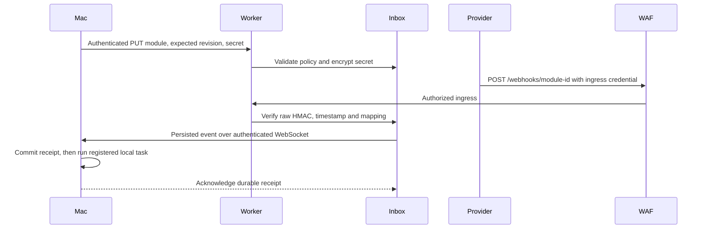

# Configurable webhook modules

Register a JSON module from the Mac without rebuilding or redeploying the Worker. GitHub review and CI handling remains a built-in adapter with its existing repository and author policy. Generic modules share the durable inbox and outbound WebSocket, and use a separate local task registry.



## Files

```text
repo/
  src/modules.ts          # Shared JSON schema, authentication and mapping
  src/module-admin.ts     # Mac administration client
  src/module-tasks.ts     # Durable local receipts and registered commands
  relay/modules.ts        # Encrypted durable registry
  examples/module.json    # Illustrative module; replace its provider fields
  examples/tasks.json     # Illustrative local task; replace its absolute paths
private configuration/
  config.json             # tasksFile and Keychain references
  tasks.json              # Locally authorized task definitions
```

The setup command provisions distinct `event-bridge/prod/admin-token`, `event-bridge/prod/module-secret-key` and `event-bridge/prod/ingress-token` Keychain entries and Worker secrets. Existing transport and GitHub webhook credentials are retained. Never rotate the encryption key without first migrating the encrypted provider secrets. Losing it makes those secrets unreadable.

## Local task registration

Copy and adapt [the task example](../examples/tasks.json). Add `tasksFile` pointing to this private JSON file and `adminTokenEntry` pointing to the administration Keychain entry in the installation configuration. Restart the daemon once when adding these configuration keys. Subsequent edits to the task file are observed through filesystem events; no periodic scan or restart is needed. Write the file atomically, particularly when replacing it from another program.

```bash
node src/cli.ts tasks-check /path/to/config.json
```

Each task fixes its module ID, executable, argv, working directory, timeout and enabled flag locally. Executable and working directory paths must be absolute. Webhook data is passed only as one JSON envelope on stdin; it never changes argv or selects a shell command. Standard output and standard error are discarded; the handler should manage its own private output artifacts. `completed` records an exit code of zero, not proof of a business outcome.

For a task whose working directory is in a Git checkout, set `repo` to that configured repository's canonical `owner/name`. Unscoped Git working directories are refused. Occupied, dirty or quarantined repositories are deferred. GitHub repairs and module tasks share repository exclusion and the configured global parallelism cap. A newly detected owner cancels an active module task. Failed, cancelled and interrupted actions become blocked and require reconciliation before explicit retry.

Do not grant a handler unnecessary filesystem or network authority. A registered executable is trusted local code; this facility is not a sandbox for downloaded code.

## Worker registration

Adapt [the module example](../examples/module.json). Store its provider webhook secret in Keychain with `creds set` using protected stdin or its masked prompt. The JSON configuration contains no secret value.

```bash
node src/cli.ts modules-put /path/to/config.json /path/to/module.json provider/prod/webhook-secret 0
node src/cli.ts modules-get /path/to/config.json
```

`0` means create only. Updates require the exact current revision returned by `modules-get`. Pass `-` instead of a secret entry to retain the existing secret. To pause a module, set `enabled` to `false` and upload it with its current revision. An uncertain network result must be reconciled with `modules-get` before retrying a write. The API never returns provider secrets or ciphertext.

Administration uses `GET` and `PUT /admin/modules`, with both the existing client bearer and a distinct `X-Bridge-Admin` credential. The Mac client retrieves both from Keychain. Provider secrets are encrypted with AES-GCM before persistence, with the module identity authenticated as associated data. Configuration updates use optimistic revisions.

## Authentication and input mapping

- HMAC algorithms: `SHA-256` and `SHA-512`.
- Signature encodings: `hex` and `base64`; optional prefix, such as `sha256=`.
- Header names use lowercase in configuration. A signature `field` selects comma-separated `key=value` components and permits a bounded set of candidate signatures for rotation.
- `signature.parts` concatenates `raw-body`, fixed `literal` text and named `header` values in provider-defined order. Exactly one raw body is required. JSON is parsed only after signature verification.
- Optional `signature.timestamp` selects a header or one of its comma-separated fields and limits age in seconds. It must also occur in the signed parts. Units are Unix seconds. Protocols with other timestamp formats require an adapter change.
- `eventId` selects a stable ID from the signed body using an RFC 6901 JSON Pointer, or from a signed header. The durable ID is namespaced by module and hashes that provider ID. Changing mappings does not replay a previously acknowledged event ID.
- `filters` apply exact scalar equality; all must match. `inputs` explicitly maps JSON Pointer values, signed header values or fixed constants. Missing inputs reject the event.
- Every header used by event ID, filters or inputs must be covered by the HMAC signing parts. Unauthenticated headers cannot change execution parameters or bypass deduplication.

The registry accepts at most 128 modules, each with at most 8 KiB of serialized policy. Mapped events are limited to 8 KiB, leaving room below the Mac's transport bound. Unknown properties, algorithms and executable code are rejected. A new protocol outside these primitives still requires a code update.

## Edge protection

The deployed generic ingress requires a separate `X-Bridge-Ingress` credential before Worker execution, then independently verifies the provider HMAC. Configure that custom header in the provider. The ingress credential is stored in Keychain as `event-bridge/prod/ingress-token`; never put it in a URL or public module JSON.

A provider that cannot send this custom header needs an explicitly configured alternative edge policy, such as provider IP restrictions. Registering a module does not silently relax WAF rules. The built-in GitHub endpoint continues to use GitHub source networks and GitHub HMAC; it does not need the generic custom header. Keep workers.dev and preview URLs disabled.

## Recovery

Inspect both `jobs` and `moduleJobs` with `node src/cli.ts status`. After independently reconciling a blocked action, use the same explicit recovery command as GitHub events:

```bash
node src/cli.ts retry /path/to/config.json EVENT_ID --reconciled
```

Restart the service after manual recovery to wake the queued job. Never replay an uncertain external action merely because the process restarted. Local task definitions and execution receipts stay on the Mac; only the explicitly mapped event inputs and the module policy enter the Cloudflare durable inbox.
